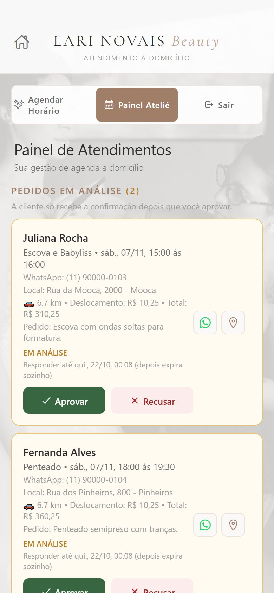
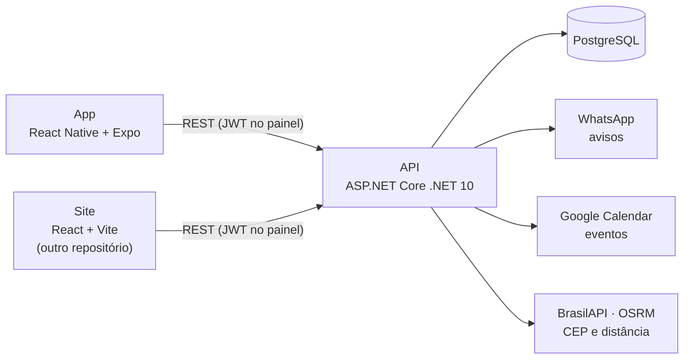
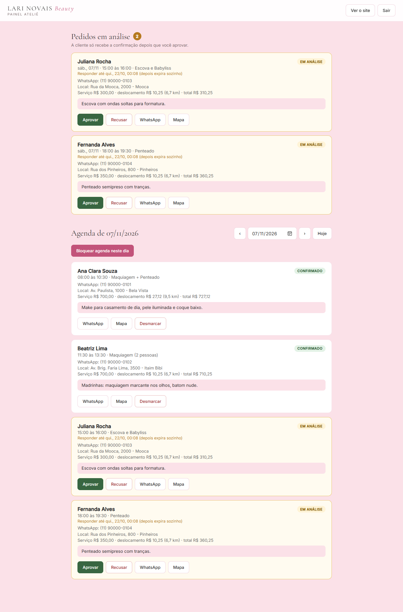

# Lari Novais Beauty — Agendamento de Maquiagem a Domicílio

Sistema de agendamento feito para uma maquiadora profissional de São Paulo que atende a domicílio. A **cliente** escolhe o serviço, o dia e o horário de início, descreve o que deseja, anexa fotos de referência e já vê a taxa de deslocamento calculada pelo CEP. A **maquiadora** aprova ou recusa cada pedido num painel protegido por login, e os avisos saem pelo WhatsApp.

Este repositório reúne a **API** (.NET) e o **app** (React Native). O site institucional, que usa a mesma API, está em [lari-novais-beauty-site](https://github.com/araujogbs/lari-novais-beauty-site).

**Em produção:** API em `https://api.larinovaisbeauty.com.br` (VPS com Docker, PostgreSQL e Caddy) e site em [larinovaisbeauty.com.br](https://larinovaisbeauty.com.br). Veja [Publicação (deploy)](#publicação-deploy).

<p align="center">
  
  
  
  
</p>
<p align="center"><sub>App: início, serviços, horários livres e painel da maquiadora (dados fictícios)</sub></p>

## Como funciona



1. A cliente faz o pedido pelo app ou pelo site. Ele nasce **em análise** e já segura o horário.
2. A maquiadora recebe o aviso e **aprova** (a cliente recebe a confirmação e o evento vai para a agenda) ou **recusa** (com motivo opcional).
3. Sem resposta em **3 dias**, uma tarefa em segundo plano expira o pedido, libera o horário e avisa a cliente.

## Destaques técnicos

- **Sem conflito de horários, nem com pedidos simultâneos:** a regra é checada no código e garantida por uma *exclusion constraint* do PostgreSQL (índice GiST com `tstzrange`).
- **Fluxo de aprovação com estados** (`Pending` → `Confirmed` / `Rejected` / `Expired`) e um `BackgroundService` que expira pedidos parados. Aprovar, recusar e expirar usam `UPDATE` condicional, o que evita condição de corrida entre a maquiadora e a tarefa automática.
- **Taxa de deslocamento calculada no servidor:** CEP → rua (BrasilAPI) → coordenadas da rua (Nominatim, com as da BrasilAPI de reserva) → distância de carro (OSRM, com Haversine de reserva). O valor enviado pelo cliente nunca é confiado.
- **Segurança:** JWT com papel `Admin`, senha guardada em hash, limite de requisições por IP, upload validado pelos bytes do arquivo, fotos servidas só por rota autenticada e segredos (incluindo dados pessoais) fora do Git.
- **Fuso de Brasília de ponta a ponta:** tudo em UTC no banco, com conversão na entrada e na saída.
- **App organizado por responsabilidade:** telas, componentes, hooks, serviços de API e utilitários separados, com TypeScript e ESLint.

## Stack

| Parte | Tecnologias |
|---|---|
| API | ASP.NET Core (.NET 10), Entity Framework Core, PostgreSQL (Npgsql), JWT Bearer, Swagger |
| App | React Native 0.86, Expo SDK 57, TypeScript, Axios, react-native-calendars |
| Integrações | WhatsApp e Google Calendar (em modo simulação até serem configuradas), BrasilAPI, Nominatim, OSRM |

O mesmo painel da maquiadora também existe no site:

<p align="center"></p>

---

A seguir, a documentação técnica completa: regras de negócio, modelo de dados, referência da API, configuração e como rodar.

---

## Sumário

1. [Funcionalidades](#funcionalidades)
2. [Estrutura do repositório](#estrutura-do-repositório)
3. [Regras de negócio](#regras-de-negócio)
4. [Modelo de dados](#modelo-de-dados)
5. [Referência da API](#referência-da-api)
6. [Configuração e segredos](#configuração-e-segredos)
7. [Como rodar](#como-rodar)
8. [Publicação (deploy)](#publicação-deploy)
9. [Testando no celular](#testando-no-celular)
10. [Segurança](#segurança)
11. [Limitações conhecidas e próximos passos](#limitações-conhecidas-e-próximos-passos)

---

## Funcionalidades

### Cliente
- **Escolha do serviço**, com duração e preço.
- **Calendário em português** e horários livres calculados na hora, em blocos de 30 minutos.
- **Dados do atendimento:** nome, WhatsApp (com máscara), **CEP** (máscara `00000-000`), endereço e número/complemento.
- **Taxa de deslocamento automática:** ao digitar o CEP, o app preenche rua e bairro e mostra a distância até o ateliê e a taxa (ou "deslocamento gratuito"). A taxa é somada ao valor total.
- **Descrição obrigatória** de como a cliente quer o serviço.
- **Fotos de referência opcionais:** até 5 imagens (JPG, PNG ou WebP, 5 MB cada), com miniaturas e botão para remover.
- **Meus Agendamentos:** a cliente digita o WhatsApp, vê os agendamentos futuros ("Em análise" ou "Confirmado") e pode cancelar (pedido em análise a qualquer momento; confirmado com mais de 24 h de antecedência).
- **Tela de agendamento concluído:** ao confirmar, a cliente vê o resumo e é levada (botão ou automaticamente após 6 s) para "Meus Agendamentos", já com o telefone preenchido.

### Maquiadora (Painel Ateliê)
Acesso escondido: **toque longo de 4 segundos** no título da tela inicial, seguido de login (usuário e senha). O mesmo painel existe no site, em `/#painel` (veja o README do Site).
- **Pedidos em análise** no topo do painel (de qualquer data), com **Aprovar** e **Recusar** (com motivo opcional) e o prazo para responder (3 dias; depois o pedido expira sozinho). Só depois de aprovar a cliente recebe a confirmação e o evento vai para o Google Calendar.
- Lista de atendimentos por dia, com serviço, horário, WhatsApp, endereço, descrição do pedido e **fotos de referência**.
- **Atalho do WhatsApp:** abre a conversa com uma mensagem de confirmação pronta.
- **Atalho do mapa:** abre o endereço no Google Maps (só aparece se houver endereço).
- **Desmarcar** um atendimento confirmado.
- **Bloquear agenda** (dia inteiro ou intervalo de horas, com motivo) e **desbloquear**.
- Sessão por JWT; ao expirar, o app volta para o login.

### Automações
- **WhatsApp** em cada etapa: "pedido recebido, em análise" ao agendar; confirmação ao aprovar; aviso (com o motivo) ao recusar; aviso quando o pedido expira sem resposta. A maquiadora vê os pedidos novos no Painel Ateliê.
- Criação do evento no **Google Calendar** ao **aprovar**, com nome, telefone, endereço, descrição, quantidade de fotos, valor e deslocamento.

---

## Estrutura do repositório

```
API e App/
├── AgendamentoApi/                  # Backend .NET
│   ├── Controllers/
│   │   ├── AppointmentsController.cs  # Agendamentos, horários, bloqueios, fotos, "meus agendamentos"
│   │   ├── AuthController.cs          # Login do administrador (JWT)
│   │   └── ServicesController.cs      # Catálogo de serviços
│   ├── Data/AppDbContext.cs
│   ├── DTOs/
│   │   ├── CreateAppointmentDto.cs    # Criação (multipart: dados + imagens)
│   │   ├── BlockSlotDto.cs            # Bloqueio de agenda
│   │   ├── RejectAppointmentDto.cs    # Motivo opcional da recusa
│   │   └── MyAppointmentDto.cs        # Resposta enxuta da cliente + ClientCancelDto
│   ├── Models/                        # Appointment, ServiceItem, AppointmentStatus (status e prazo de 3 dias)
│   ├── Services/
│   │   ├── TravelFeeService.cs        # CEP -> distância -> taxa de deslocamento
│   │   ├── WhatsAppService.cs         # Mensagens por WhatsApp (interface + implementação)
│   │   ├── GoogleCalendarService.cs   # Evento no Google Calendar (interface + implementação)
│   │   ├── PendingExpirationService.cs # Tarefa em segundo plano que expira pedidos sem resposta
│   │   └── BrazilTime.cs              # Fuso de Brasília
│   ├── Migrations/                    # Histórico do banco
│   ├── uploads/                       # Fotos enviadas (criada em runtime, fora do Git)
│   ├── devlog.md                      # Diário de desenvolvimento
│   ├── Dockerfile · .dockerignore     # Imagem de produção (usuário sem privilégios, fotos em /data/uploads)
│   └── Program.cs                     # CORS, JWT, rate limit, proxy reverso, EF Core, /health, injeção de dependência
├── deploy/                          # Produção num VPS: docker-compose (Postgres + API + Caddy), backup e passo a passo
└── agendamento-mobile/              # App Expo
    ├── App.tsx                        # Raiz: navegação entre telas, aviso (toast) e visualizador de fotos
    ├── assets/                        # Imagem de fundo, ícones
    └── src/
        ├── screens/
        │   ├── WelcomeScreen.tsx        # Tela inicial (toque longo no título abre o painel)
        │   ├── booking/                 # Fluxo da cliente
        │   │   ├── BookingScreen.tsx      # Etapas e serviços
        │   │   ├── ServiceStep.tsx        # Etapa 1: lista de serviços
        │   │   ├── DetailsStep.tsx        # Etapa 2: dia, horário, dados e confirmação
        │   │   └── PeopleSelector · AddressSection · DescriptionSection · BookingTicket
        │   ├── SuccessScreen.tsx        # Agendamento concluído
        │   ├── MyAppointmentsScreen.tsx # Consulta e cancelamento pelo WhatsApp
        │   ├── AdminLoginScreen.tsx     # Login da maquiadora
        │   └── admin/                   # Painel Ateliê
        │       ├── AdminScreen.tsx        # Pedidos em análise e agenda do dia
        │       ├── AdminAppointmentCard.tsx
        │       └── BlockSchedule.tsx      # Bloqueio de dia ou intervalo
        ├── components/                # AppHeader, Toast, Lightbox, Stepper, Skeleton
        ├── hooks/                     # useToast, useBookingForm (estado do formulário)
        ├── services/
        │   ├── api.ts                 # Axios com o token JWT no header
        │   ├── auth.ts                # Login e armazenamento do token (AsyncStorage)
        │   └── appointments.ts        # Chamadas à API (cliente e painel)
        ├── utils/                     # Formatação, datas (fuso de Brasília), erros, links
        ├── styles/common.ts           # Estilos compartilhados entre telas
        ├── config/calendarLocale.ts   # Calendário em português
        └── theme.ts · constants.ts · types.ts
```

O site institucional, que usa a mesma API, fica em outro repositório: [lari-novais-beauty-site](https://github.com/araujogbs/lari-novais-beauty-site) (localmente, na pasta `../Site`).

---

## Regras de negócio

- **Expediente:** 06:00 às 22:00, fuso de Brasília (`America/Sao_Paulo`). Tudo é gravado em **UTC** no banco e convertido na entrada e na saída.
- **Sem sobreposição de horários.** A regra é garantida em duas camadas:
  1. consulta no código (`InicioNovo < FimExistente` e `FimNovo > InicioExistente`);
  2. **constraint de exclusão do PostgreSQL** (`no_overlapping_appointments`, índice GiST com `tstzrange`), que impede conflito mesmo com duas marcações simultâneas. Nesse caso a API responde `409`.
- **Todo agendamento novo nasce em análise** (`Pending`) e já **segura o horário**, para ninguém pedir o mesmo. A maquiadora aprova (`Confirmed`) ou recusa (`Rejected`).
- **Prazo de 3 dias** (`AppointmentStatus.PendingExpiration`): o `PendingExpirationService` roda ao subir a API e a cada 30 min, e passa para `Expired` os pedidos em análise criados há mais de 3 dias ou cujo horário já passou. O horário é liberado e a cliente recebe um aviso pelo WhatsApp. O painel mostra o prazo de cada pedido (`expiresAt`).
- Agendamentos **cancelados**, **recusados** e **expirados** não ocupam horário (lista `AppointmentStatus.FreeSlot`, a mesma da constraint do banco).
- **Bloqueios** são gravados como agendamentos de status `Blocked`, então os horários somem da lista de livres automaticamente. Só é possível bloquear onde não há agendamento.
- **A cliente escolhe o horário de início** (`startTime`). O servidor calcula o término somando a duração total: `término = startTime + duração do serviço × pessoas`. O atendimento inteiro precisa caber no expediente (se o término passar das 22:00, a API responde `400`). Os horários livres já vêm filtrados para isso.
- **Quantidade de pessoas (`People`):** o valor do serviço e a duração são multiplicados pelo número de pessoas; a taxa de deslocamento não.
- **Descrição** é obrigatória (até 1000 caracteres); **fotos** são opcionais (máx. 5, 5 MB cada).
- **Cancelamento pela cliente:** pedido em análise pode ser cancelado a qualquer momento; confirmado, só com **mais de 24 h** de antecedência. Com menos, a API devolve `400` orientando a cancelar pelo WhatsApp.
- **Taxa de deslocamento** (configurada em `TravelFee`, calculada no servidor a partir do CEP):
  - A distância é medida a partir do ponto de partida da maquiadora (`TravelFee:OriginLatitude`/`OriginLongitude`, nos segredos). Sem esse ponto configurado, a API não calcula taxa e o agendamento segue sem ela.
  - Os primeiros `FreeRadiusKm` (5 km) são isentos; acima disso, `(distância − 5) × R$ 5,00 por km × 2` (**ida e volta**), arredondado a 2 casas.
  - Endereço do CEP: **BrasilAPI** (`/api/cep/v2`). Coordenadas: **Nominatim/OpenStreetMap** (busca estruturada por rua, cidade e UF, com cache por CEP). As coordenadas da BrasilAPI ficam só de reserva, porque para muitos CEPs ela devolve o centro da cidade (em São Paulo, o mesmo ponto para todos).
  - Distância de carro: **OSRM**; se falhar ou passar de 3 s, usa Haversine × 1,3.
  - O `POST /appointments` recalcula a taxa a partir do `cep`; o valor enviado pelo app nunca é confiado.
- Status usados (constantes em `Models/AppointmentStatus.cs`): `Pending` (em análise), `Confirmed`, `Rejected`, `Expired` (3 dias sem resposta), `Cancelled`, `Blocked`.

---

## Modelo de dados

**ServiceItem** (`Services`)

| Campo | Tipo | Observação |
|---|---|---|
| Id | int | PK |
| Name | string | Ex.: "Maquiagem Social" |
| DurationMinutes | int | Duração do atendimento |
| Price | decimal | |
| IsActive | bool | Desativa sem apagar o histórico |

**Appointment** (`Appointments`)

| Campo | Tipo | Observação |
|---|---|---|
| Id | int | PK |
| ClientName | string | |
| ClientPhone | string | WhatsApp, salvo com máscara |
| ClientAddress | string? | Endereço do atendimento |
| Description | string? | Como a cliente quer o serviço |
| TravelFee | decimal? | Taxa de deslocamento (ida e volta) calculada pelo CEP |
| DistanceKm | double? | Distância até o ateliê, em km |
| ReferenceImages | text[] | Nomes dos arquivos em `uploads/` |
| ServiceItemId | int | FK para o serviço |
| People | int | Para quantas pessoas é o serviço (padrão 1) |
| StartTime / EndTime | timestamptz | UTC. `StartTime` é o início escolhido; `EndTime` é o término previsto, calculado |
| Status | string | `Pending`, `Confirmed`, `Rejected`, `Expired`, `Cancelled` ou `Blocked` |
| CreatedAt | timestamptz | |

**Migrations** (em ordem): `CriarTabelaServicos`, `CriarTabelaAgendamentos`, `AdicionarEnderecoAgendamento`, `AdicionarClientAddress`, `AdicionarConstraintSemSobreposicao` (anti-sobreposição), `AdicionarDescricaoEImagens` (`Description` e `ReferenceImages`), `AdicionarTaxaDeslocamento` (`TravelFee` e `DistanceKm`), `AdicionarQuantidadePessoas` (`People`), `AtualizarServicosSocial`, `AdicionarStatusPendente` (a constraint anti-sobreposição passa a ignorar também os recusados) e `AdicionarStatusExpirado` (e os expirados).

A migration `AtualizarServicosSocial` atualiza preços e durações dos serviços do Social, os mesmos mostrados no site:

| Serviço | Duração | Preço |
|---|---|---|
| Maquiagem | 60 min | R$ 380 |
| Penteado | 90 min | R$ 380 |
| Escova e Babyliss | 60 min | R$ 300 |

A migration `SinalEVariosServicos` leva os preços de maquiagem e penteado a R$ 380 e desativa o antigo combo "Maquiagem + Penteado": no Social a cliente marca **mais de um serviço** e o valor e a duração somam. O pedido grava `ServiceItemIds`, `ServiceNames` e `TotalPrice` (mudar o preço depois não altera pedidos antigos) e, ao ser aprovado, `DepositAmount` (o sinal). `DepositPaidAt` é preenchido quando a maquiadora marca que recebeu.

---

## Referência da API

Base: `http://<IP>:5102/api`. A documentação interativa (Swagger) fica em `/swagger`, só em ambiente de desenvolvimento.

### Serviços
| Método | Rota | Acesso | Descrição |
|---|---|---|---|
| GET | `/services` | Público | Lista serviços ativos |
| GET | `/services/{id}` | Público | Busca um serviço |
| POST | `/services` | Admin | Cadastra serviço (o `Id` enviado é ignorado) |

### Autenticação
| Método | Rota | Acesso | Descrição |
|---|---|---|---|
| POST | `/auth/login` | Público (5/min por IP) | Body `{ "Username", "Password" }`. Devolve `{ token }` (JWT válido por 2 h). `401` se inválido, `503` se o admin não estiver configurado |

### Agendamentos
| Método | Rota | Acesso | Descrição |
|---|---|---|---|
| GET | `/appointments/available-slots?date=AAAA-MM-DD&serviceId=1&people=1` (ou `serviceIds=1,3`) | Público | Horários de **início** livres (`["10:00","10:30",...]`) em que a duração total (serviço × pessoas) cabe sem conflito até as 22:00. Horários que já passaram não entram. `people` é opcional (padrão 1, máx. 20) |
| GET | `/appointments/availability?from=AAAA-MM-DD&days=31&serviceId=1&people=1` (ou `serviceIds=1,3`) | Público | Quantos horários de início livres há em cada dia do período (`[{ "date": "2026-10-19", "slots": 12 }, ...]`), usado no calendário do site. `days` de 1 a 62 |
| POST | `/appointments` | Público (10 por 10 min por IP) | Cria agendamento e devolve só `{ id, manageToken }` (o código secreto). **`multipart/form-data`**: `clientName`, `clientPhone`, `clientAddress`, `description` (obrigatório), `serviceItemIds` (um ou mais, repetido no form), `startTime` (ISO 8601 com offset/UTC: início do atendimento), `people` (1 a 20, padrão 1), `cep` (opcional, recalcula a taxa) e `images` (0 a 5 arquivos). `409` se o horário estiver ocupado |
| GET | `/appointments/estimate-fee?cep=` | Público (15/min por IP) | Rua, bairro, cidade, `distanceKm` e `travelFee` para o CEP. `400` CEP inválido, `404` não encontrado |
| POST | `/appointments/lookup` | Público (10/min por IP) | Body `{ "tokens": ["12.abc..."] }`. Devolve os agendamentos futuros (em análise ou confirmados) dos códigos secretos válidos, cada um com `manageToken`. **Nunca se busca por telefone**: sem o código, saber o número de alguém não dá acesso ao agendamento dela. Nos confirmados com sinal a pagar vêm `depositAmount` e `pixCode` (PIX copia e cola). O código é `id.assinatura` (HMAC com chave derivada de `Jwt:Key`): nada é gravado no banco e o link de WhatsApp (`/#ag=código`) pode ser reenviado sempre |
| POST | `/appointments/{id}/client-cancel` | Público (10/min por IP) | Body `{ "token": "..." }`. Cancela se o código bater: pedido em análise a qualquer momento, confirmado só com mais de 24 h |
| GET | `/appointments?date=AAAA-MM-DD` | Admin | Lista os agendamentos do dia (inclui bloqueios) |
| GET | `/appointments/pending` | Admin | Pedidos futuros em análise, de qualquer data (cada um com `expiresAt`, o prazo para responder) |
| POST | `/appointments/{id}/approve` | Admin | Aprova um pedido em análise: vira `Confirmed`, envia a confirmação por WhatsApp e cria o evento no Google Calendar. `409` se não estiver mais em análise |
| POST | `/appointments/{id}/deposit-paid` | Admin | Marca que o sinal do pedido confirmado foi recebido (`depositPaidAt`). `409` se não estiver confirmado |
| POST | `/appointments/{id}/reject` | Admin | Recusa um pedido em análise (body opcional `{ "reason": "..." }`): vira `Rejected`, libera o horário e avisa a cliente. `409` se não estiver mais em análise |
| PATCH | `/appointments/{id}/status` | Admin | Desmarca um atendimento ou desfaz um bloqueio. Só aceita `"Cancelled"` (string JSON) |
| POST | `/appointments/block-slot` | Admin | Bloqueia agenda: `{ date, startTime?, endTime?, reason? }` (sem horários = expediente todo) |
| GET | `/appointments/images/{arquivo}` | Admin | Serve uma foto de referência |

Rotas de admin exigem o header `Authorization: Bearer <token>`.
Excedeu o limite de requisições por IP, a API responde `429`.

Fora de `/api` há também `GET /health` (`{ "status": "ok" }`), para monitoramento (UptimeRobot e afins).

### Fotos de referência
- Salvas em `AgendamentoApi/uploads/` com nome aleatório (GUID); o nome original nunca é usado.
- O tipo é conferido pelos **primeiros bytes** do arquivo (JPEG, PNG, WebP), sem confiar em extensão ou Content-Type.
- Só a maquiadora logada acessa as fotos, pela rota protegida. Elas não ficam em pasta pública.
- Se o agendamento falhar (conflito ou erro de banco), as fotos já gravadas são apagadas.

---

## Configuração e segredos

Segredos **não** ficam no repositório. Em desenvolvimento use **User Secrets** (o projeto já tem `UserSecretsId`); em produção, variáveis de ambiente (`Chave__Subchave`).

| Chave | Obrigatória | Descrição |
|---|---|---|
| `ConnectionStrings:DefaultConnection` | Sim | Conexão com o PostgreSQL |
| `Jwt:Key` | Sim | Chave de assinatura do JWT, **mínimo 32 bytes** (a API não sobe sem ela) |
| `Jwt:Issuer` / `Jwt:Audience` | Sim | Já definidos em `appsettings.json` (`AgendamentoApi`) |
| `Admin:Username` | Sim | Usuário do painel |
| `Admin:PasswordHash` | Sim | Hash da senha no formato do ASP.NET Identity (`PasswordHasher`). Nunca a senha em texto |
| `Deposit:Percent` | Não | Percentual do total cobrado como sinal depois da aprovação (padrão 30) |
| `Pix:Key` / `Pix:MerchantName` / `Pix:MerchantCity` | Não | Chave PIX que recebe o sinal e nome/cidade que aparecem no pagamento. Sem a chave, não há "copia e cola" |
| `WhatsApp:PhoneNumberId` / `WhatsApp:AccessToken` | Não | WhatsApp Cloud API oficial (Meta), com modelos aprovados (`deploy/whatsapp-templates.md`). Sem isso, a mensagem só aparece no log (simulação) |
| `GoogleCalendar:CredentialsJsonPath` / `GoogleCalendar:CalendarId` | Não | Sem isso, o evento só aparece no log (simulação) |
| `TravelFee:OriginLatitude` / `TravelFee:OriginLongitude` | Sim, para cobrar deslocamento | Coordenadas do ponto de partida da maquiadora. **Dado pessoal: só nos segredos**, nunca no repositório. Sem elas, a taxa não é calculada |
| `TravelFee:FreeRadiusKm` / `TravelFee:PricePerKm` | Não | Já em `appsettings.json`: 5.0 km grátis e R$ 5,00 por km |
| `Storage:UploadsPath` | Não | Pasta das fotos de referência. Padrão: `AgendamentoApi/uploads`. No Docker: `/data/uploads` (volume) |
| `Database:MigrateOnStartup` | Não | `true` aplica as migrations pendentes ao subir (usado no `deploy/`) |
| `Cors:AllowedOrigins` | Produção | Lista de origens de navegador permitidas (`Cors__AllowedOrigins__0`, `__1`...). Vazia fora de desenvolvimento = nenhuma origem liberada. O app mobile nativo não depende de CORS |

```bash
cd AgendamentoApi
dotnet user-secrets set "ConnectionStrings:DefaultConnection" "Host=localhost;Port=5432;Database=agendamento_db;Username=postgres;Password=..."
dotnet user-secrets set "Jwt:Key" "uma-chave-aleatoria-com-pelo-menos-32-caracteres"
dotnet user-secrets set "Admin:Username" "lari"
dotnet user-secrets set "Admin:PasswordHash" "<hash gerado>"
dotnet user-secrets set "TravelFee:OriginLatitude" "<latitude do ponto de partida>"
dotnet user-secrets set "TravelFee:OriginLongitude" "<longitude do ponto de partida>"
```

`dotnet user-secrets list` mostra o que já está definido na máquina. O `dotnet ef` também lê esses segredos.

**Gerando o `Admin:PasswordHash`:** no servidor, `deploy/set-admin-password.sh` pede a senha sem mostrá-la e grava o hash no `.env` (Python, mesmo formato Identity v3). Na máquina de desenvolvimento, num projeto de console temporário (fora do repositório), com o pacote `Microsoft.AspNetCore.Identity`:

```csharp
var hasher = new Microsoft.AspNetCore.Identity.PasswordHasher<string>();
Console.WriteLine(hasher.HashPassword("lari", "SUA_SENHA"));
```

O primeiro argumento (`"lari"`) deve ser igual ao `Admin:Username`.

---

## Como rodar

### Pré-requisitos
- .NET SDK 10
- PostgreSQL com extensão `btree_gist` (a migration cria com `CREATE EXTENSION IF NOT EXISTS`; o usuário do banco precisa de permissão para isso)
- Node.js e npm
- Ferramenta do EF Core: `dotnet tool install --global dotnet-ef`

### Backend
```bash
cd AgendamentoApi
dotnet ef database update          # aplica as migrations
dotnet run --launch-profile http   # sobe em http://0.0.0.0:5102
```
A API escuta em `0.0.0.0:5102` com CORS liberado, para o celular alcançá-la na rede local. Cadastre pelo menos um serviço (`POST /api/services` ou direto no banco) para a tela inicial ter o que listar.

### Mobile
```bash
cd agendamento-mobile
npm install
```
Edite `src/services/api.ts` e coloque o **IP da sua máquina** em `baseURL` (ex.: `http://192.168.0.2:5102/api`), e depois:
```bash
npx expo start --clear
```

Comandos úteis no app: `npx tsc --noEmit` (tipos), `npm run lint` (ESLint do Expo) e `npx expo-doctor` (diagnóstico). Instale pacotes sempre com `npx expo install <pacote>`, para o Expo escolher a versão compatível.

---

## Publicação (deploy)

A pasta [`deploy/`](deploy/README.md) tem tudo para subir a API num VPS com Docker (passo a passo completo no README dela):

- **`docker-compose.yml`**: PostgreSQL 17 (volume), a API (imagem do `AgendamentoApi/Dockerfile`, fotos num volume) e o **Caddy**, que emite e renova o certificado HTTPS sozinho e repassa o IP real da cliente. A porta da API não fica exposta: só o Caddy fala com ela.
- **`.env.example`**: senhas, chave JWT, login do painel, domínios, ponto de partida e integrações. Copie para `.env` no servidor (nunca vai para o Git).
- **`seed-servicos.sql`**: cadastra os 4 serviços do Social no banco novo (pode rodar de novo sem duplicar).
- **`backup.sh`**: backup diário do banco (`pg_dump`) e das fotos, guardando 14 dias. Copie a pasta `backups/` para fora do servidor.

- **`set-admin-password.sh`**: define a senha do Painel Ateliê digitada sem aparecer na tela; só o hash (formato ASP.NET Identity v3) vai para o `.env`.

No servidor as migrations rodam sozinhas ao subir (`Database__MigrateOnStartup=true`). Se usar a Cloudflare no DNS, deixe o registro `api.` como **"DNS only"**: com o proxy laranja ligado, o IP que chega na API seria o da Cloudflare e o limite por IP deixaria de funcionar.

### Produção atual

| Parte | Onde |
|---|---|
| API, banco e HTTPS | VPS Ubuntu 24.04 (4 GB), Docker Compose em `/opt/lari/api/deploy`, certificado Let's Encrypt pelo Caddy |
| Domínio | `larinovaisbeauty.com.br` no registro.br, DNS na Cloudflare com DNSSEC; `api` como "DNS only" |
| Site | Cloudflare Workers (arquivos estáticos), ligado ao GitHub: cada push na `master` publica |
| Acesso ao servidor | só por chave SSH, com o usuário `deploy` (root e senha desligados) |
| Proteção | firewall (22, 80 e 443), fail2ban e atualizações de segurança automáticas |
| Backup | diário às 03:00 (banco e fotos, 14 dias), em `deploy/backups/` no próprio servidor |

Atualizar a API em produção: `cd /opt/lari/api && git pull && cd deploy && docker compose up -d --build`. A preparação do servidor está documentada em [`deploy/README.md`](deploy/README.md).

---

## Testando no celular

1. PC e celular na **mesma rede Wi-Fi**.
2. Abra o **Expo Go** e escaneie o QR code (`exp://<IP-do-PC>:8081`).
3. No Windows, libere a porta da API no firewall (PowerShell como administrador):
   ```powershell
   New-NetFirewallRule -DisplayName "AgendamentoAPI 5102" -Direction Inbound -Protocol TCP -LocalPort 5102 -Action Allow -Profile Any
   ```
4. Para conferir a conexão, abra `http://<IP-do-PC>:5102/api/services` no navegador do celular. Deve aparecer um JSON.

**Problemas comuns**
- *"Não foi possível carregar os serviços"* — firewall bloqueando a 5102, IP errado em `api.ts`, ou API fora do ar. O app registra o motivo no terminal do Expo.
- *`Native module is null, cannot access legacy storage`* — versão do AsyncStorage incompatível com o Expo Go. O projeto usa a **2.2.0** (a que o Expo Go traz).
- *Build do .NET falha com "arquivo bloqueado"* — a API está rodando e trava o executável. Pare a API antes de compilar ou de rodar `dotnet ef`.
- *Erro de módulo nativo ao abrir o seletor de fotos* — faça um development build (`npx expo run:android` ou `eas build --profile development`).

---

## Segurança

Já implementado:
- Painel e rotas administrativas protegidos por **JWT** com papel `Admin` (validação de emissor, audiência, expiração e assinatura).
- Senha do admin guardada como **hash** (ASP.NET Identity), com comparação em tempo constante; a API recusa subir sem `Jwt:Key` forte.
- Upload de imagens validado por conteúdo, com limite de quantidade e tamanho. Os nomes são gerados no servidor, o que evita *path traversal*.
- Fotos das clientes só são servidas por rota autenticada.
- Cancelamento pela cliente devolve a **mesma resposta** para "não existe" e "telefone não confere", sem revelar agendamentos de terceiros.
- O app não registra senhas nem tokens nos logs.
- Segredos e dados pessoais fora do Git (User Secrets e variáveis de ambiente): conexão do banco, chave JWT, login do painel e ponto de partida da maquiadora.
- `POST /api/services` exige papel `Admin`; o `Id` enviado pelo cliente é ignorado.
- **Limite de requisições por IP** (`429`): login 5/min, consulta e cancelamento de agendamentos 10/min, criação de agendamentos 10 a cada 10 min. Dificulta força bruta de senha e a descoberta de telefones.
- **CORS restrito:** em produção só as origens de `Cors:AllowedOrigins`; liberado geral apenas em desenvolvimento, e só com os métodos e headers necessários.
- **HTTPS forçado em produção** (redirecionamento + HSTS) e headers `X-Content-Type-Options: nosniff` e `X-Frame-Options: DENY`.
- **Atrás do proxy reverso** (fora de desenvolvimento), a API lê `X-Forwarded-For` e `X-Forwarded-Proto`, então o limite por IP vale por cliente, e não para todo mundo junto com o IP do proxy. Isso só é seguro porque a porta da API não é exposta fora da rede do Docker.

---

## Limitações conhecidas e próximos passos

- **"Meus Agendamentos" usa só o telefone como prova de identidade.** O limite por IP dificulta, mas não impede, que alguém que saiba o WhatsApp de uma cliente veja e cancele os agendamentos dela. Para endurecer de vez: código de verificação por SMS/WhatsApp.
- **WhatsApp e Google Calendar ainda em simulação em produção** (as mensagens e os eventos só aparecem no log). O `WhatsAppService` envia no formato da Evolution API **v1** (`textMessage: { text }`). O plano é usar a **API oficial da Meta** (Cloud API, com modelos de mensagem aprovados), de preferência em coexistência com o WhatsApp Business do número atual.
- **Backup só no próprio servidor.** Falta copiar `deploy/backups/` para fora (ex.: `rclone` para Backblaze B2 ou Google Drive).
- **A janela de 3 meses do calendário existe só no site.** A API ainda aceita pedidos para qualquer data futura enviados direto.
- O cálculo de deslocamento depende de serviços gratuitos (BrasilAPI, Nominatim, OSRM público) sem garantia de disponibilidade; o OSRM público tem limites de uso, e em produção vale hospedar o próprio. Se o CEP não puder ser localizado, o agendamento segue sem taxa.
- Cancelar um atendimento **não remove** o evento do Google Calendar.
- O IP da API está fixo em `src/services/api.ts`; o ideal é usar variável de ambiente do Expo.
- Fotos ficam em disco (`uploads/`, ou o volume `/data/uploads` no Docker), com backup pelo `deploy/backup.sh`. Com muito volume, vale migrar para armazenamento em nuvem.
- A criação de agendamento (`POST /appointments`) ainda não recusa um `startTime` no passado; só as listas de horários deixaram de oferecê-los.
- Horário de verão não é tratado no app (o fuso fixo `-03:00` é usado ao montar o horário); a API usa o fuso real de São Paulo.
- `GoogleCalendarService` usa `GoogleCredential.FromStream`, marcado como obsoleto pelo Google (aviso `CS0618` no build); migrar para `CredentialFactory` ao ligar a integração de verdade.
- Ideias: lembrete automático (24 h antes), reagendamento, cadastro de serviços pelo painel, notificações push para a maquiadora.
